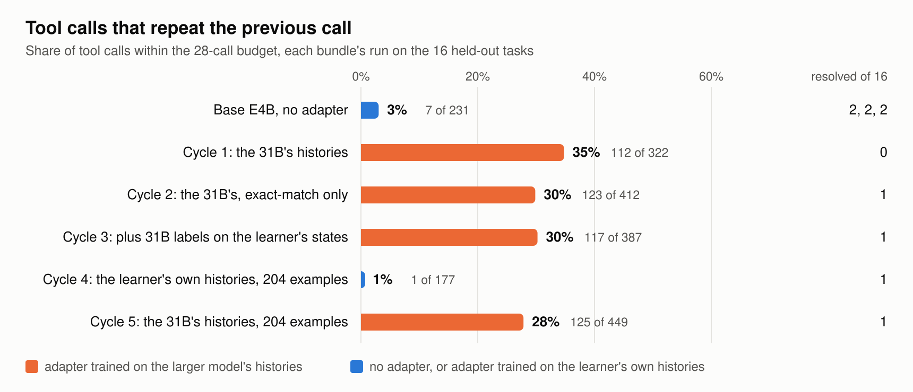
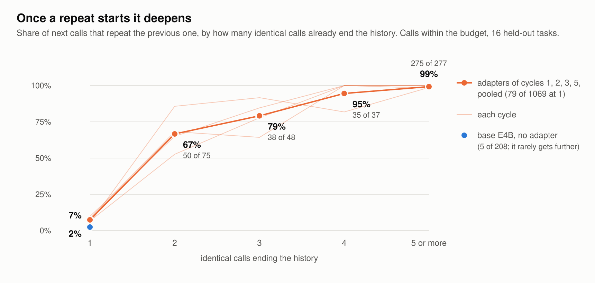
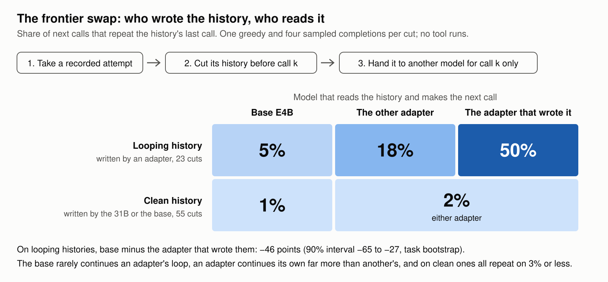

# Where the histories come from

**Subtitle:** Five post-training cycles and two prompts on a Gemma 4 coding agent, with every step a verified record

Draft 12, 2026-11-12 (Draft 10 with a third and fourth read's points: the 449, two hedges, a limitation, wording): Draft 9 (`docs/paper-draft-lora-draft9.md`) revised on a second outside review: repeats are
now counted within the 28-call budget (the harness refuses later calls and Draft 9 counted them), the expert-label
table is split at the cap, and the review's wording points are taken. This note and the subtitle label are not part of the
Writeup.

## Abstract

Fine-tuning a small coding agent on a larger agent's verified runs lowered its held-out loss and made it loop. We ran
five post-training cycles on a Gemma 4 agent in the competition's unchanged harness, each training a
LoRA on the small 4-bit E4B model, with every step a checkable record and each adoption decision made by a rule
written before the evidence; none was adopted. The four adapters trained on the 31B agent's verified
histories repeated their previous tool call on 28 to 35% of calls within the call budget against the base's 3%; their task scores, 0 or 1 of
16 against 2, sit inside rerun noise. The loop deepens itself: an adapter starts a repeat on 7% of calls and, five
identical calls in, continues 99% of the time. A frontier swap, which cuts a recorded history before one call and hands it to
another model for that call only, crosses weights with history: on a looping history the adapter that wrote it repeats
50% of the time, another adapter 18% and the base 5%; on clean histories written by the base or the 31B all repeat on 3% or less. The 31B joins
an established loop in 15 of 17 states, all from one task, and one round of its labels did not stop the looping. An
adapter trained on the learner's own resolved rollouts did not loop and did not gain; a pre-registered control
trained on the 31B's histories at the same size and settings looped at 28% within budget. Two prompt arms did not move the score.
We close with a hypothesis the one-model rule excludes: an agent that
switches models per step.

## 1. Introduction

We ran a post-training loop under one discipline: every input selected by a stated rule, every transformation reproducible from recorded
files, every adoption decision fixed before its evidence. Nothing we trained helped, so the question the cycles can answer is what decides whether post-training harms or does
nothing. The five cycles point to the title's answer: the source of the training histories.

| term | meaning |
|---|---|
| history | an attempt's sequence of tool calls and results so far |
| executor | the model that produces the next call |
| learner | Gemma 4 E4B, the small model, in its 4-bit form |
| teacher, expert | the 31B agent |
| resolved | the task's hidden tests pass on the final patch |
| bundle | the folder the harness runs as an agent: configuration, prompts, sampling settings, any adapter |
| cell | the public bundle's budget per task: 8 minutes, 28 tool calls, 80 turns |
| repeat, repeat loop | a tool call identical, name and arguments, to the one before it; a run of them |
| rendering | a recorded history turned back into the prompt tokens the server would see |
| signed | the writer's signature covers a record's content and its inputs' digests |
| gate | a pass or fail check on swap results, set before training, for cycles 3 and 4 |

Contributions: that loop, with its records and pre-registered rule; five rejected cycles with a matched control; and
the frontier swap, a next-call probe that crosses an adapter's weights with the history it reads.

## 2. Related work

Fine-tuning on filtered successes is established: STaR [1], ReST [2], and SWE-Gym and SWE-smith [3] for coding agents.
Training on another policy's histories and running on one's own is the compounding-error setting DAgger [4] addresses
by labelling the learner's states, the exposure bias of sequence models [5], and the mismatch on-policy
distillation corrects [6]. Self-reinforcing repetition is documented for text generation [7]; we observe it in tool calls. Imitating a stronger model's outputs is reported to transfer
style more than capability [8]. Routing between cheap and expensive models is established [9, 10]. LoRA [11] is the adapter form the harness accepts; run-to-run variance in agentic evaluation
[12] bounds what 16 tasks can show. Within the competition, [13] audits task
soundness and [14] ships LoRA trajectories and a recipe.

## 3. Setup

We use the organizers' harness [15] unmodified (swegemma 0.2.11, vLLM
0.19.1) on Kaggle's pinned 4×L4 image (L4x4), with the public Budget-Fit starter bundle [16]. 68 public tasks from two
repositories (rich 39, fastapi 29) are sound in both evaluation environments we used: the harness's verifier passes
them on the gold patch and fails them on an empty one (audits in [13, 17]). Sixteen are held out, drawn per repository
in sha256(seed:task) order (rich 9, fastapi 7); the other 52 are training tasks.

After the 28th tool call the harness refuses further ones but lets the model keep asking until turn 80. Repeat rates
count the calls before an attempt's first refusal (post hoc; section 4.1 reports the rest).

The 31B is released in a 4-bit and a 16-bit (bf16) form. Under the 8-minute clock the 4-bit one resolves 28 of 68
against 19.5, means over repeated runs, so it is the submitted agent (27 of 68 on first attempts), the main teacher
(cycle 1 also used the 16-bit release's runs) and the control for section 5.

## 4. The loop

**Select.** Rule, fixed before any example was drawn: an attempt contributes if hidden tests resolved it, it ran 31B on Kaggle, its task is not held out and its trace is in a signed digest list;
one example per model call. From 388 records: 78 attempts, 31 tasks, 1,436 examples.

**Render.** An example is useful only if the tokens trained on are the tokens served, so every rendering is checked
against vLLM's reported prompt token count. Of 808 4-bit examples, 274 follow a compaction by the agent framework that
the trace does not keep and 74 carry a JSON-escaping offset; 460 match exactly and 441 of those also reproduce the
completion. The 628 bf16 examples used a different chat template, so only their completions are checked: 502 pass.

**Train.** The W4A16 E4B weights decompressed to the values vLLM serves; LoRA r = 16 on every projection, 34.9 M
parameters; loss on completion tokens; examples over 16,384 prompt or 4,096 completion tokens dropped; learning rate 1e-4, cosine schedule with warmup; each cycle holds out a few of its own attempts for its
held-out loss.

**Accept.** The adapter and the base run the harness unchanged on the 16 held-out tasks at the cell, one attempt
each, at the bundle's sampling temperature of 0.2. Rule, written before either arm ran: adopt only if the adapter resolves at least 2 more than the base, given that one or two tasks in ten flip outcome between identical reruns.

| cycle | training histories | examples | epochs, alpha | update norm | held-out loss | resolved of 16 | tool calls that repeat |
|---|---|---|---|---|---|---|---|
| base | none | | | | | 2, 2, 2 | 3% |
| 1 | 31B, both releases | 847 | 1, 16 | 2.13 | 0.43 to 0.31 | 0 | 35% |
| 2 | 31B, exact-match 4-bit | 435 | 1, 8 | 0.89 | 0.80 to 0.60 | 1 | 30% |
| 3 | cycle 2's, plus 31B labels at the learner's states | 672 | 1, 8 | 1.12 | 0.42 to 0.32 | 1\* | 30% |
| 4 | the learner's own resolved rollouts | 204 | 2, 8 | 0.81 | 0.31 to 0.27 | 1 | 1% |
| 5 | 31B, exact-match 4-bit, cut to cycle 4's size | 204 | 2, 8 | 0.91 | 0.80 to 0.62 | 1 | 28% |

Examples are those trained on, after the length drop and each cycle's held-out split; held-out loss is on that split
(five examples for cycles 2 and 5, so no measurement) and is not comparable across rows. Update norm is the Frobenius norm
of the whole served update (alpha/r)·B·A. Cycle 3 failed its gate, so its task run (\*) is exploratory. None was adopted.

*Figure 1. Repeat rate per bundle on the held-out tasks.*

### 4.1 Cycles 1 and 2: the teacher's histories

The cycle 1 adapter fell into repeat loops: 53 of its 322 calls ran reasoning to the 4,096-token cap (base: 2 of 231). The targets
are not repetitive (1 exact copy in 844 consecutive pairs): loss on the teacher's histories improved while generation on the agent's own histories degenerated.

Cycle 2 was pre-registered before cycle 1's arm returned, with the same data, base, split and rule but only the
exact-match examples; alpha 8 and one epoch were set after cycle 1's result and are labelled post hoc. Ten of its 16
tasks had three or more repeats. Served at half scale (update norm 1.06) on four training tasks, cycle 1's adapter had largely stopped
looping; cycle 2, smaller still, looped, so strength alone does not explain it, and nor does the template difference in cycle 1's bf16 examples.

*Figure 2. The chance of repeating, by how many identical calls already end the history.*

The loop deepens itself (Figure 2, post hoc). Pooled over the four adapters trained on the 31B's histories, an adapter
repeats on 7% of calls after a non-repeat, on 67% after one repeat and on 99% once five or more identical calls
end the history; the base starts a repeat on
2%. The repeated calls change nothing: reads and commands are 91 to 100% of them,
where six of the base's seven repeats are edit retries, and the adapters edit about a third as often as the base or less.

The base and cycle 4 never reach the call cap. The four looping adapters reach it on 8 to 16 tasks and keep
asking: 1,719 further calls, most refused, 81% repeating the one before. Counted over all calls, their repeat rates are 54 to 59%.

### 4.2 The instrument: the frontier swap

Do the adapter's weights make it repeat whatever its history, or does a history full of repeats make any E4B repeat?
Cut a recorded history before model
call *k*, hand it to another executor and ask for the next call only: no tool runs. This is DAgger's query of an
expert at the learner's states [4], with token-exact admission and writer crossed with reader. A signed tool fixed the cuts before
any output (31B and base attempts at calls 4, 8 and 12; adapter attempts at their first repeat and four calls later),
admitting 78 of 145 cut histories, or prefixes, by exact token count: 23 *looping* ones from adapter attempts and 55
*clean* ones from 31B and base attempts, all before the call cap. Each executor gives one greedy and four sampled completions (temperature
0.2) per prefix; a completion repeats when
its first tool call equals the prefix's last, and edits when it is an edit or write. Differences are paired, with 90%
intervals from 2,000 task-cluster bootstraps and analysis rules fixed before the run.

*Figure 3. The frontier swap.*

On a looping history the adapter that wrote it repeats 50% of the time, the other adapter 18% and the base 5% (the
split by writer is post hoc); base minus writer is −46 points [−65, −27]. On clean histories the adapters differ from
base by +2 and 0; none of these is adapter-written, and in their own rollouts adapters start a repeat on 7% of calls. The loop needs the adapter and a looping history, and an adapter's own loop holds
it far more than another's. Every looping cut was adapter-written, from 11 tasks. Admission was uneven, 15 of 30
first-repeat cuts against 8 of 28 four calls later, since compaction removes long
histories, so the looping set leans early. On clean histories the adapters' next call is an edit 9% and 11% of the
time against the base's 36%.

### 4.3 Cycle 3: the expert labels the learner's states

One round of expert labelling, a weak test of DAgger [4]. Cycle 2 was rolled out on 12 of
the 52 training tasks; the 31B gave one greedy next call at each of the
277 states whose rendering matches the served count; cycle 3 trained on cycle 2's examples plus these;
plan, gate and rule fixed before the rollouts. The expert's labels, by how many identical calls
end the history:

| identical calls ending the history | 0 or 1 | 2 | 3 or 4 | 5 or more |
|---|---|---|---|---|
| states before the call cap | 181 | 4 | 2 | 15 |
| expert repeats | 0 | 0 | 2 | 13 |

The split at the cap is post hoc: 75 of the 277 states follow it, and there the expert repeats 73 refused calls. Before it, the expert repeats in 15 of the 17 states ending in three or more identical calls, all from one task
where the learner kept re-running a broken grep. So, on thin evidence, the expert
fails in the states it was asked to correct. The gate asked for fewer repeats than cycle 2 on looping swap prefixes and an edit rate on clean ones within 15 points of the base's. Cycle 3 passed the first, 20% against 30% (−9 points [−17, −2]), and failed the second, 14% against
36%. A post-hoc adapter trained without the 89 rows ending in three or more identical calls, on either side of the cap, behaved
the same, so those labels alone do not keep cycle 3 looping.

### 4.4 Cycle 4: the learner's own histories

The base bundle at temperature 0.7 with the clock lifted,
six rollouts over the 52 training tasks: 312 attempts, 34 resolved on 12 tasks. The render check kept 229 of their examples, and cycle 4 trained from the base for two epochs on 204. Its gate, fixed before
the rollouts, asks that on clean prefixes it neither repeat more than the base (90% upper bound within 5 points) nor
edit much less (within 15). It passed: repeat −0.1 points [−1.1, +1.1], edit +1.2 [−4.2, +6.4]; on looping prefixes it repeats 2% against cycle 2's 30%.

### 4.5 Cycle 5: the matched control

Cycle 4 differs from cycles 1 to 3 in size and epochs as well as in its histories. The control, registered before any draw or run: 204 of cycle 2's exact-match teacher examples, drawn
in hash order, cycle 4's settings, read as looping at a repeat rate of 20% or more and as not looping
at 10% or less. It repeated on 125 of 449 calls within budget (one malformed call did not count against the budget), 28%, and on 56% of all 1,114; 9 of 16 tasks had three or more repeats.

**What the cycles show.** The four adapters trained on the 31B's histories, whole, cut to 204 examples or as labels on
the learner's states, fell into repeat loops; the one trained on the learner's own did not. Update size does not separate them: cycle 4's norm, 0.81, sits beside the looping 0.89 and 0.91. Cycle 5 rules out
example count and epochs, and cycle 2 the template difference. What remains, once those are matched, is the source of
the histories, which bundles authorship, style and task coverage. Style is the leading candidate: the loops are reads and commands, and these adapters edit about a third as often as the base or less.

## 5. The prompt as a lever: two arms

Both arms change the prompt, not the weights; both were pre-registered and run once. **E4B** submits unchecked fixes:
after its last edit, the last command succeeded in 7 of 16 attempts. Told to check after every edit, it resolved 3 of
16 against a bar of 4. **31B** does not loop; 22 of its 41 unresolved first attempts end at the call cap. It was told to search once and read 150-line windows. The bar for resubmission was 33 of 68:

| 31B, first attempts on 68 tasks | window arm | submitted |
|---|---|---|
| resolved | 29 | 27 |
| ended at the 28-call cap | 22 | 22 |
| first edit at call, median | 8 | 10.5 |
| read window in lines, median (150 asked) | 61 | 25 |

It followed the instruction in direction and the outcome did not move: the +2, seven arm-only against five
control-only, is inside the ±4 seen between identical reruns.

## 6. Discussion

**What transfers.** Fix the adoption rule against measured rerun noise before evaluating. Do not read held-out loss alone as progress: cycle 1 improved it by 28%
while repeating on 35% of calls, so measure the repeat rate in free-running rollouts. And probe recorded histories one
call at a time: the swap runs no tools and tested two explanations in 26 minutes.

**A hypothesis.** The competition requires one model per submission [15]. The
swap shows that a history can be handed to another model for a call, so an agent need not be one
model: a cheap model could take most steps and an expensive one be called on the same history, with no imitation and so
no training mismatch, a cascade [9, 10] per step. Our evidence on when to switch is negative: on one task the expert did not
rescue an established loop, and the unadapted learner rarely loops. We have not
run such an agent.

## 7. Limitations

Sixteen held-out tasks and one attempt per adapter arm: each verdict is a single draw against a flip rate of one or two in ten. Only the per-call repeat rates, over hundreds of calls, are well powered, and calls within an attempt are not
independent. One teacher, one learner, one rank, one seed per cycle, no search. The
controlled contrast, cycle 4 against cycle 5, is one draw each, and the two still differ in task coverage (12 tasks
against 30); the teacher differs from the learner in size and style as well as authorship. We did not test a guard
against identical consecutive calls: bundles admit no code. Cycle 4's
rollouts sample at temperature 0.7, evaluation at 0.2. Cycle 2's settings, cycle 3's second adapter and the count within budget are post
hoc and labelled. Style as the cause is untested, as is the swap on adapter-written histories before the first repeat.  All tasks are
public.

## 8. Verification and resource

Each step's output names its inputs' digests. The tools that write these records are signed, and ordering claims rest on the
decision log and Kaggle's version timestamps. Released [17]: every attempt record and trace, dataset, adapter,
gate, plan and decision record, the decision log, the prompt-arm bundles, the soundness table, a verifier and the
public key. About 34 L4x4 hours on Kaggle
plus 4 Modal A100 hours for cycle 3.

## References

1. Zelikman, Wu, Mu, Goodman. STaR: Bootstrapping Reasoning With Reasoning. NeurIPS 2022; arXiv:2203.14465.
2. Gulcehre, Le Paine, Srinivasan et al. Reinforced Self-Training (ReST) for Language Modeling. arXiv:2308.08998, 2023.
3. Pan, Wang, Neubig, Jaitly, Ji, Suhr, Zhang. Training Software Engineering Agents and Verifiers with SWE-Gym. arXiv:2412.21139. Yang, Lieret, Jimenez, Wettig, Khandpur, Zhang, Hui, Press, Schmidt, Yang. SWE-smith: Scaling Data for Software Engineering Agents. NeurIPS 2025; arXiv:2504.21798.
4. Ross, Gordon, Bagnell. A Reduction of Imitation Learning and Structured Prediction to No-Regret Online Learning (DAgger). AISTATS 2011; arXiv:1011.0686.
5. Bengio, Vinyals, Jaitly, Shazeer. Scheduled Sampling for Sequence Prediction with Recurrent Neural Networks. NeurIPS 2015; arXiv:1506.03099.
6. Agarwal, Vieillard, Zhou, Stanczyk, Ramos, Geist, Bachem. On-Policy Distillation of Language Models: Learning from Self-Generated Mistakes. ICLR 2024; arXiv:2306.13649.
7. Xu, Liu, Yan, Cai, Li, Li. Learning to Break the Loop: Analyzing and Mitigating Repetitions for Neural Text Generation. NeurIPS 2022; arXiv:2206.02369.
8. Gudibande, Wallace, Snell, Geng, Liu, Abbeel, Levine, Song. The False Promise of Imitating Proprietary LLMs. arXiv:2305.15717, 2023.
9. Chen, Zaharia, Zou. FrugalGPT: How to Use Large Language Models While Reducing Cost and Improving Performance. arXiv:2305.05176, 2023.
10. Ong, Almahairi, Wu, Chiang, Wu, Gonzalez, Kadous, Stoica. RouteLLM: Learning to Route LLMs with Preference Data. ICLR 2025; arXiv:2406.18665.
11. Hu, Shen, Wallis, Allen-Zhu, Li, Wang, Wang, Chen. LoRA: Low-Rank Adaptation of Large Language Models. ICLR 2022; arXiv:2106.09685.
12. Bjarnason, Silva, Monperrus. On Randomness in Agentic Evals. ICLR 2026; arXiv:2602.07150.
13. Gluzdov, Dmitrii. Gemma 4: Measure Before You Tune (now titled "Gemma 4: Task Soundness, Serving and Evaluation"). Kaggle notebook, October 2026. https://www.kaggle.com/code/dmitriigluzdov/gemma-4-measure-before-you-tune.
14. Gluzdov, Dmitrii. Gemma 4 Serving and LoRA Verification Kit. Kaggle dataset, CC BY 4.0, 2026-10-20. https://www.kaggle.com/datasets/dmitriigluzdov/gemma-4-serving-and-lora-verification-kit.
15. Google and Kaggle. Gemma 4 Developer Agent competition: rules and the swegemma harness (0.2.11). 2026. https://www.kaggle.com/competitions/gemma-4-developer-agent.
16. Henao, W. E. Gemma 4 Agent: Budget-Fit Single Agent. Kaggle notebook, October 2026, Apache-2.0. https://www.kaggle.com/code/verracodeguacas/gemma-4-agent-budget-fit-single-agent.
17. Lilley, L. gemma-agent records: every attempt record, trace, signed item, gate and decision record, the public key and a verifier. Kaggle dataset, CC0, 2026. https://www.kaggle.com/datasets/leolilley/gemma-agent-records.
